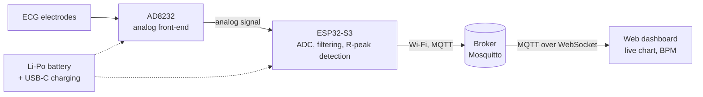

# ECG Holter with MQTT Streaming


A portable ECG recorder that streams the signal in real time over Wi-Fi to a server using the MQTT protocol. The recorded signal is visualized live in a web dashboard.

Developed as an engineering thesis project in Computer Science at the Faculty of Automatic Control, Electronics and Computer Science, Silesian University of Technology (Politechnika Śląska).

---

## Table of contents

- [How it works](#how-it-works)
- [Hardware](#hardware)
- [Software](#software)
- [Repository structure](#repository-structure)
- [Project status](#project-status)
- [Safety](#safety)
- [License](#license)

---

## How it works



1. The **AD8232** module amplifies and pre-filters the signal from the electrodes.
2. The **ESP32-S3** samples the signal with its ADC, applies digital filtering (high-pass and 50 Hz notch), detects R-peaks and calculates the heart rate.
3. Samples are sent in batches over **MQTT** to a Mosquitto broker.
4. The **web dashboard** subscribes to the data via MQTT over WebSocket and draws the ECG waveform live.

## Hardware

Custom PCB designed in KiCad 10, powered by a Li-Po battery.

| Block | Components | Function |
|---|---|---|
| USB-C input | GCT USB4105, USBLC6-2SC6 | Charging and programming, ESD protection |
| Charging | MCP73831 | Li-Po charging at 500 mA (CC/CV, 4.2 V) |
| Power path | AO3401A, SS14 | Automatic source selection: USB or battery |
| Regulator | AP2112K-3.3 | 3.3 V supply (up to 600 mA) |
| Microcontroller | ESP32-S3-WROOM-1-N8 | Acquisition, processing, Wi-Fi |
| ECG front-end | AD8232 module | ECG signal amplification and filtering, lead-off detection |
| Monitoring | Voltage dividers | Battery level, USB connection detection |

## Software

| Part | Technology |
|---|---|
| Firmware | ESP32-S3, Arduino / PlatformIO |
| Transport | MQTT |
| Broker | Mosquitto (with WebSocket support) |
| Dashboard | HTML / JavaScript, mqtt.js, real-time chart |

## Repository structure

```
├── hardware/        # KiCad project: schematic, PCB, libraries, fabrication files
├── firmware/        # ESP32-S3 firmware
├── server/          # Mosquitto broker configuration
├── dashboard/       # web dashboard
└── docs/            # documentation, photos, measurement results
```

## Project status

- [x] Concept and component selection
- [ ] Schematic (in progress)
- [ ] PCB layout and board order
- [ ] Breadboard prototype: ECG sampling
- [ ] MQTT streaming
- [ ] Web dashboard with live chart
- [ ] Bring-up of the custom PCB
- [ ] Digital filtering and heart rate detection
- [ ] Tests: latency, packet loss, battery life

## Safety

> [!WARNING]
> This is an educational prototype, **not a medical device**. It is not intended for diagnosis or health monitoring.
>
> When electrodes are attached to the body, the device must be powered **from the battery only**. Never attach electrodes while the board is connected via USB to a computer or a mains-powered charger. The firmware disables ECG acquisition when USB voltage is detected.

## License

- Software (`firmware/`, `server/`, `dashboard/`): [MIT](LICENSE)
- Hardware design (`hardware/`): [CERN-OHL-S-2.0](hardware/LICENSE)

## Author

[Full name] · Engineering thesis, Silesian University of Technology, [year]
Supervisor: [title, full name]
